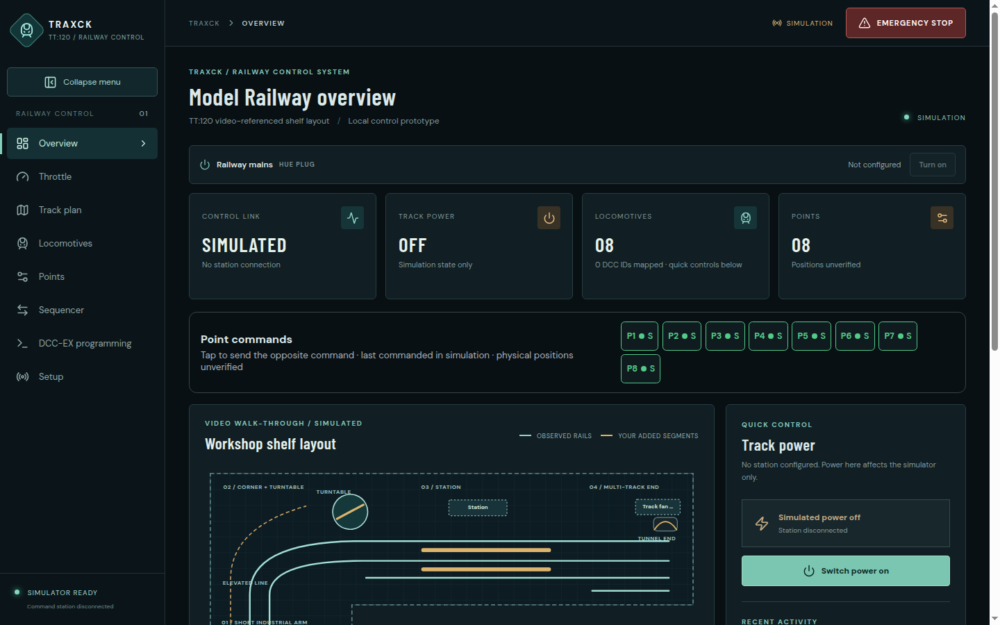

# Traxck

A self-hosted model railway simulator, track-plan and roster editor, and graphical journey sequencer with optional DCC-EX hardware control. Use a fresh local database to explore in simulation; keep the backend accessible only on your own computer. This source release does **not** include running layout data, photos, private configuration, access tokens, or the original private Git history.



### Screenshots

- [Track-plan editor](docs/screenshots/track-plan.png)
- [Locomotive roster](docs/screenshots/locomotives.png)
- [Journey sequencer](docs/screenshots/sequencer.png)

Screenshots show illustrative simulation data, not measured train positions. The software does not provide occupancy detection, route locking, or automatic conflict protection; any displayed movement estimate is not a detected location.

**All rights reserved.** No permission to redistribute the code or bundled assets is granted by this release. Supply only photos and artwork you have rights to use; no locomotive catalogue images are included.

[Donate via PayPal](https://www.paypal.com/donate/?hosted_button_id=MH4576C22MQGU)

## Prerequisites and install

- Python **3.11 or newer**, Node.js **18 or newer**, npm, and a supported operating system. Installed Pillow and `httpx2` require Python 3.11+. This project has no Docker/production hosting configuration.
- From the release root, create an isolated environment and install Python dependencies. `pytest` is a separate test dependency:

```sh
python3 -m venv .venv
.venv/bin/python -m pip install -r backend/requirements.txt pytest
npm --prefix frontend ci
npm --prefix frontend run build
```

Create your own writable private data directory, outside the distributed source if possible. The examples below use an untracked `data/` directory. Do not copy somebody else's database or tokens into this release. Set an operator token in your shell or private service environment; replace the example with a **new, randomly generated secret** and never commit it:

```sh
mkdir -p data
export WORKSHOP_DB="$PWD/data/workshop.db"
export WORKSHOP_OPERATOR_TOKEN="$(.venv/bin/python -c 'import secrets; print(secrets.token_urlsafe(32))')"
.venv/bin/python -m uvicorn backend.app:app --host 127.0.0.1 --port 8768
```

Open `http://127.0.0.1:8768/` on the same machine. First launch initializes an example roster and database, starts in **SIMULATION**, and does not connect to a command station or switch on track power. The frontend does not prompt for or send the operator token: hardware operations are deliberately unavailable through this local UI in token mode. You can edit the inventory and run simulator controls; do not change to hardware mode to test an installation.

Environment configuration (set only what you need, outside this source):

| Variable | Purpose |
| --- | --- |
| `WORKSHOP_DB` | SQLite database path; default is `data/workshop.db` in the release root. Parent directory must be writable. |
| `WORKSHOP_OPERATOR_TOKEN` | Explicit hardware-API token; absent token disables those API routes (503). Never publish it. |
| `RAILWAY_PLUG_CONFIG_FILE` | Persisted plug config path; default is `data/railway-plug.json`. Contains a Home Assistant access token if configured. |
| `RAILWAY_HA_URL`, `RAILWAY_HA_TOKEN` or `RAILWAY_HA_TOKEN_FILE`, `RAILWAY_PLUG_ENTITY_ID` | Optional plug integration. No default server, token or entity is supplied. Keep credentials outside the source. |

Uploaded roster photos live in `data/roster-photos/`. The app saves plug credentials to the JSON file above if you configure them in the UI. Use restrictive filesystem permissions for the data directory, configuration and any token file.

## Network and physical safety

**Do not expose this application to the internet, port-forward it, or put it behind a public reverse proxy.** Some inventory and plug setup operations trust the apparent loopback peer and browser-origin headers rather than a complete user authentication system. A reverse proxy can make outside requests appear to come from loopback. The optional `WORKSHOP_LAN_SUBNET` mode permits token-free hardware control to allowed peers. Keep the **production backend bound to `127.0.0.1`**; the sample command above does so. Do not interpret browser-origin checks or an operator token as sufficient to make the whole API internet-safe.

Vite's dev and preview commands can bind to **all interfaces**; do not assume they inherit the backend's loopback binding. Its `/api` proxy can relay requests to the loopback backend so they appear to originate locally. Avoid exposing Vite dev/preview on untrusted networks; use the built frontend served by the loopback backend. If you need remote access, obtain a security review and a properly authenticated, isolated deployment first.

No software emergency stop is a safety-rated power cut-off. Hardware setup requires a verified command station address/port and independently enabling track power. A configured mains-plug monitor can connect and select HARDWARE automatically when the plug reports on, and a saved mode may survive restart. Never assume restart returns an existing installation to simulation. Never use hardware commands for an installation check. See [DCC-EX notes](backend/DCCEX.md) for protocol limitations. Keep the layout supervised with a physical power disconnect.

## Tests (simulator and mocked hardware only)

From the release root, with the virtual environment and npm dependencies installed:

```sh
.venv/bin/python -m pytest -q backend/tests tests
(cd frontend && node --test src/*.test.mjs)
npm --prefix frontend run build
```

The backend tests use temporary databases and fake sockets; they are **not** a physical hardware smoke test. Do not run the server in HARDWARE mode as a verification step.

## Persistent data and backups

The source directory is **not a backup of your installation**. `data/` is intentionally excluded: back up the SQLite file (including any WAL/SHM companions, or use SQLite's online backup API), roster uploads under `data/roster-photos/`, and `data/railway-plug.json` separately, securely, and with the service stopped for a simple consistent file copy. Also back up any external database/config/token paths you set through the environment. Restore these only on your own trusted installation, with restrictive permissions; never add them to a public source export. Retain backup copies away from this release tree.
